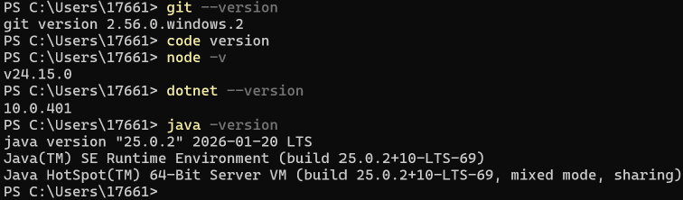
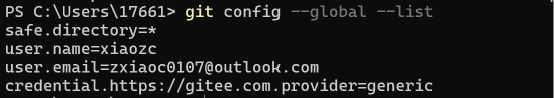
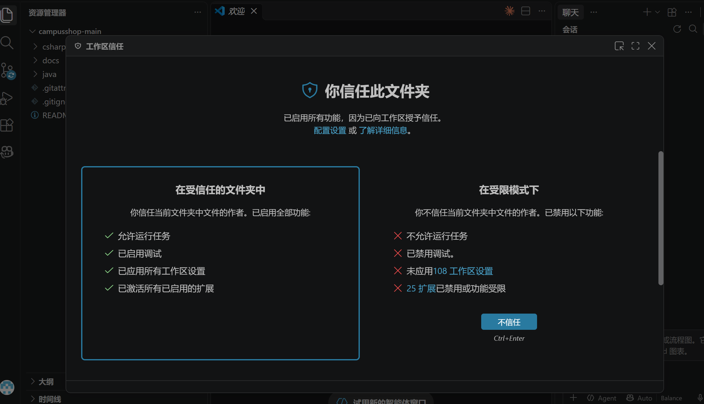
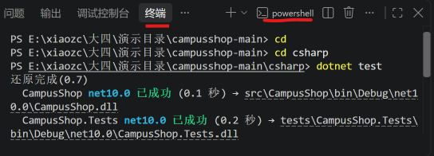
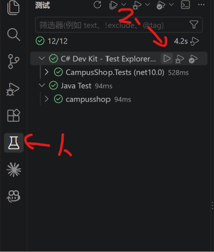
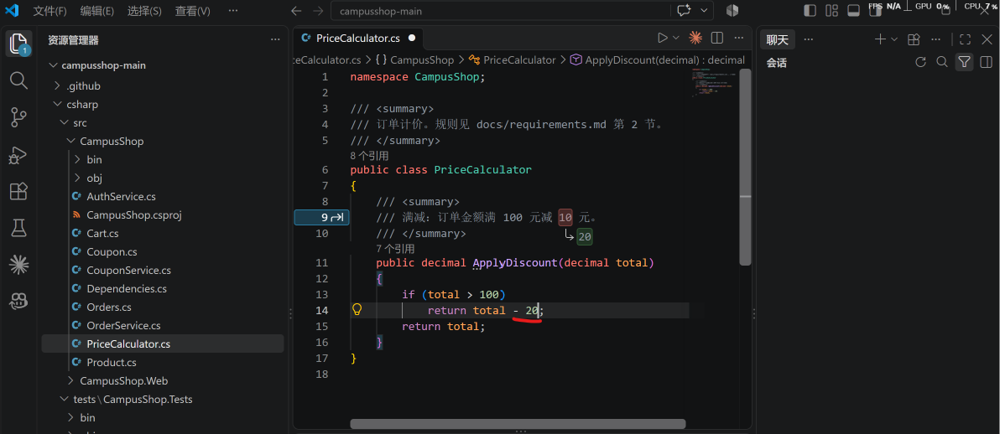
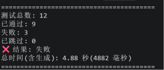

# AI辅助软件测试操作手册

## 一、环境搭建

### 1、安装软件

```
打开powershell依次输入
PS> winget install Git.Git
PS> winget install Microsoft.VisualStudioCode
PS> winget install OpenJS.NodeJS.LTS 
下面两个可以更具需求选择
#C# 版本
PS> winget install Microsoft.DotNet.SDK.10 
# Java 版本
PS> winget install EclipseAdoptium.Temurin.21.JDK
```

###### 验证环境

```
PS> git --version
PS> code --version						#会自动打开vscode
PS> node -v
PS> dotnet --version   					# C#
PS> java -version      					# Java
```



如果安装失败，可以从官网进行下载

###### 配置git身份并验证

```
PS> git config --global user.name "？？？？"					 #自己取名
PS> git config --global user.email "？？？@？？？.com"			#自定义邮箱
# 检查设置是否生效
PS> git config --global --list
```



如图所示即配置成功

###### 获取CampusShop项目

可以使用powershell克隆代码也可以直接下载压缩文件，克隆需要在gitcode平台配置安全密钥

没有上传代码到远程仓库的同学直接下载压缩包即可

###### 在命令行中运行测试

在vscode中打开文件夹campusshop-main并信任



在底部命令行powershell终端输入

```
ps>cd csharp					#进入csharp目录,Java版本写cdjava
PS>dotnet test					#运行测试,Java版本写.\mvnw test
```



###### 在VScode中运行和调试测试

点击左侧烧瓶图标,并找到自己版本的测试用例运行测试



###### 尝试调整代码观察测试情况

将csharp\src\CampusShop\PriceCalculator.cs中ApplyDiscount函数的返回值进行修改



测试结果


