# 单元测试、覆盖率与变异分数

## 一、项目管理

开始测试前先将项目上传至本地git仓库，便于代码改坏时回滚与分支管理，vscode中提供了图形界面，非常便于使用，

###### 初始化仓库

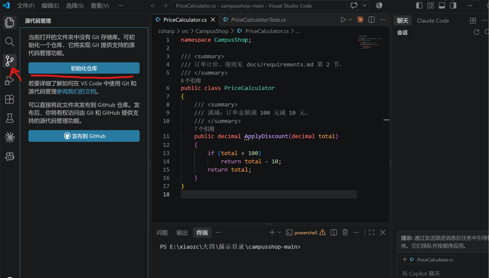

###### 第一次提交

```
1、暂存：将项目中的文件放入暂存区

2、备注：根据需求或者便于自己理解给这一次提交取名，方便后续管理

3、提交：将文件提交至commit区，此时相当于“存档”完成，后续根据需求可以“回档”
```


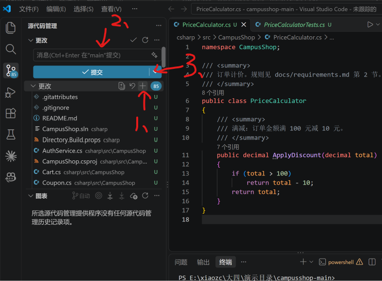

每一次做出改动，或完成一个阶段都要存档，便于项目管理


## 二、claude code插件安装与使用

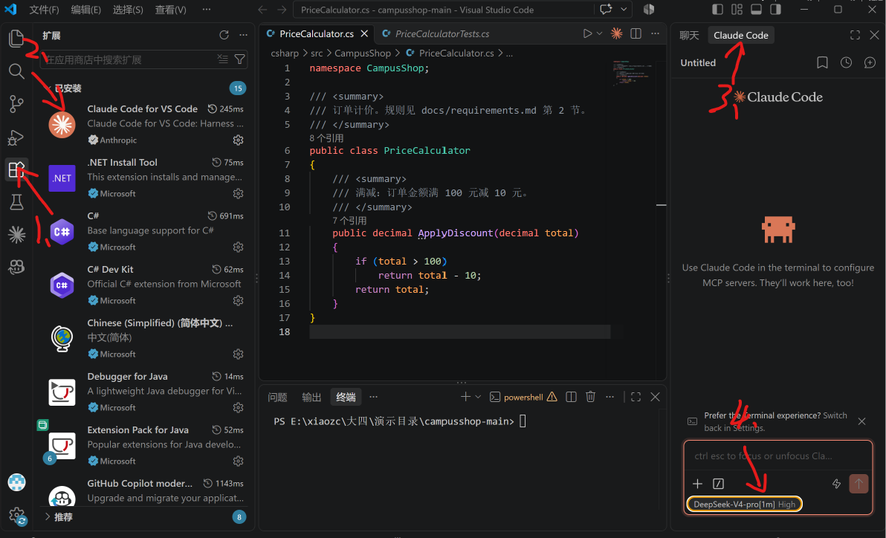

```
1、从扩展中下载插件，扩展中提供了丰富的插件，可根据需求安装
2、安装claude code插件
3、打开Claude界面
4、根据需求切换模型
```

## 三、单元测试设计

## 1、理解项目

在开始测试前，我们需要先让自己和ai读懂项目，此举可以使用少量token和小部分上下文换取更少的幻觉和更兼容规范的改动，此时不需要改动源码，如有需要也可将此类重要的内容保存成md文件，方便随时阅读,也可直接用/init命令让Claude自动生成Claude.md文档。

提示词示例：

```
/init 请你阅读@csharp文件夹下文件，严格遵守规则：				#使用java的目录不同，引用前加@
目标：
1、理解项目是做什么的，目录结构是怎样组织的，关注业务场景，模块划分以及变量与函数的命名规范
约束：
1、全程只做阅读理解，信息梳理，禁止主动提出优化，重构，修复bug，不要生成任何修改代码，改动方案
2、不要逐行解释代码，不要输出大段源码复述
3、遇到不明确的地方统一标记【待确认】，不要脑部，编造接口和逻辑
阅读后，生成：
1、项目整体用途，，业务场景
2、模块清单：各个文件夹分别负责什么功能，模块间如何调用，数据流向
3、自定义规范：命名习惯等规则
4、风险/疑问清单
```

最后如果想要将md加入项目管理记得提交，如果希望git忽略这个文件可以在.gitignore中添加该文件忽略，这样git就不会一直提示提交这个文件了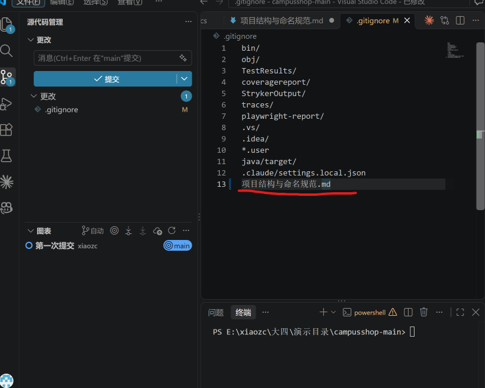

# 2、设计单元测试

接下来我们利用ai来按照测试设计方法生成测试

### （1）***\*满减边界\****

[PriceCalculator.cs:13](csharp/src/CampusShop/PriceCalculator.cs#L13) 使用 `total > 100`，需求 2.1 为"≥100 减 10"；恰好 100 元时实现不减。

提示词示例：

```
你是一名软件测试工程师。
为@csharp\src\CampusShop\PriceCalculator.cs的ApplyDiscount方法设计单元测试。需求见@docs\requirements.md第二节。

请按以下方法设计，先不要写代码：
1、等价类：分别列出原价和会员等级的有效、无效等价类。
2、边界值：找出所有边界，每个边界取三个值。
3、规则交互：考虑会员折扣与满减的组合情况。
4、汇总为用例表：|原价|会员|期望|计算过程|设计依据|期望值必须按照要求计算，并写出计算过程。

等我确认表格后，再生成参数化测试（xUnit[Theory]）。
非法输入用Assert.Throws检查具体的异常类型。
不要修改被测代码。生成后运行测试并报告结果。
```

人工校验生成的用例表，看是否符合业务需求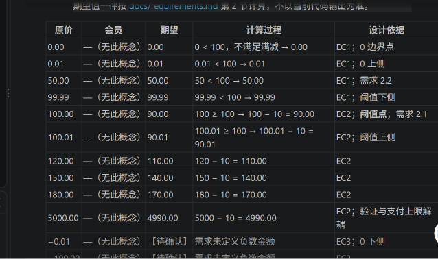

通过对话来确认细节与完善测试用例后生成测试代码，此时保留会亮红的测试用例（非法输入校验在API测试中进行）

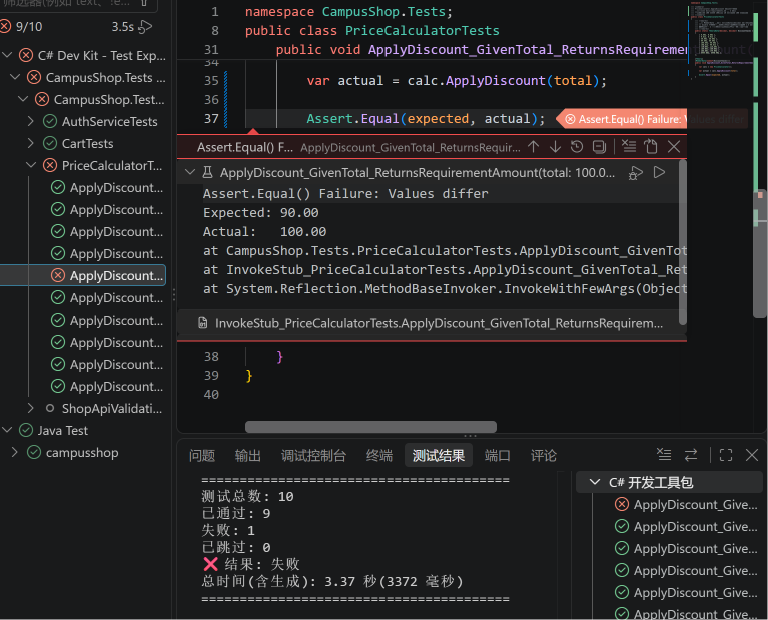

发现边界值问题，正好满100是没有满减，这是我们写用例时发现的问题，符合我们的预期，亮红灯不是错误，这说明我们的工作做到位了，测试要做的就是发现问题解决问题。

下一步，记录缺陷，写缺陷报告，最后修复业务代码

###### 让ai起草缺陷报告

```
按缺陷报告模板，为这两个失败的测试各写一份缺陷报告，引用需求条款。
不要修改任何代码。
```

###### 修复业务代码

```
修复这两个缺陷，只修改@csharp\src\CampusShop\PriceCalculator.cs，不得修改测试。
完成后运行全部测试并报告。
```

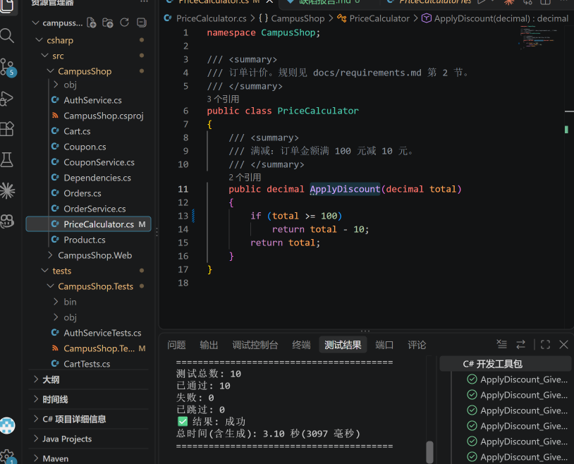

已修复，符合预期，最后，该单元测试完成，记得提交git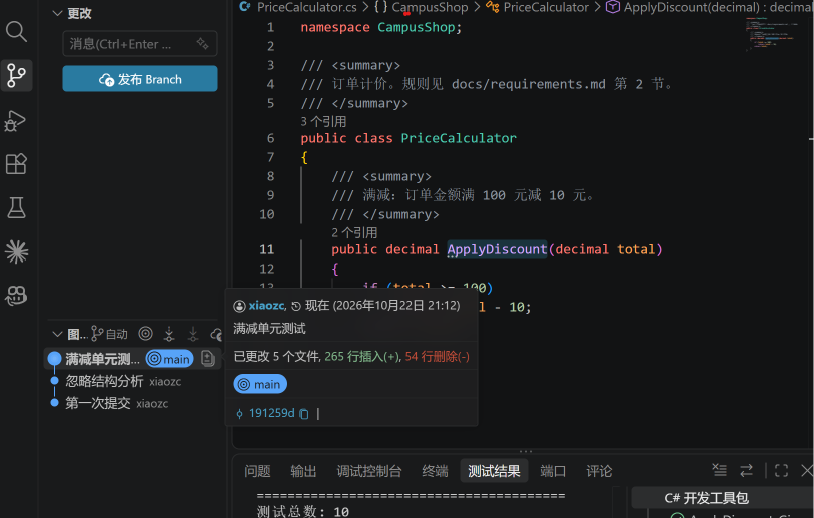

接下来，我们重复上面的操作完成**优惠券截止日**和**支付失败未恢复库存**的单元测试

### （2）***\*优惠券截止日\****

[CouponService.cs:14](csharp/src/CampusShop/CouponService.cs#L14) 使用 `today >= ExpireDate` 返回不可用，需求 3.1 明确"截止日当天仍可用"。

提示词示例：

```
你是一名软件测试工程师。
为@csharp\src\CampusShop\CouponService.cs的IsUsable方法设计单元测试。需求见@docs\requirements.md第三节。
请按以下方法设计，先不要写代码：
1、等价类：分别列出优惠卷截止日期、购物金额和使用情况的有效、无效等价类。
2、边界值：找出所有边界，每个边界取三个值。
3、规则交互：考虑优惠卷截止日期、购物金额和使用情况的组合情况。
4、汇总为用例表：|截止日期|当前日期|订单金额|券门槛|券面额|券状态|期望值|计算过程|设计依据|期望值必须按照要求计算，并写出计算过程。
等我确认表格后，再生成参数化测试（xUnit[Theory]）。
非法输入用Assert.Throws检查具体的异常类型。
不要修改被测代码。生成后运行测试并报告结果。
```

### （3）***\*支付失败未恢复库存\****

[OrderService.cs:26-L27](csharp/src/CampusShop/OrderService.cs#L26-L27) 扣库存后支付失败直接返回，未调用 `Restore`；需求 4.3 要求恢复库存。`CheckoutService` 路径则有恢复逻辑。

提示词示例：

```
你是一名软件测试工程师。
为@csharp\src\CampusShop\OrderService.cs的PlaceOrder方法设计单元测试。需求见@docs\requirements.md第四节。
请按以下方法设计，先不要写代码：
1、等价类：分别列出数量、库存和支付金额的有效、无效等价类。
2、边界值：找出所有边界，每个边界取三个值。
3、规则交互：考虑优数量、库存和支付金额的组合情况。
4、汇总为用例表：| 用例描述 | buyCount | 初始库存 | 订单金额 | 支付预期 | 通知预期 | 预期业务返回 | 最终库存 |设计依据 | 期望值必须按照要求计算，并写出计算过程。
等我确认表格后，再生成参数化测试（xUnit[Theory]）。
非法输入用Assert.Throws检查具体的异常类型。
不要修改被测代码。生成后运行测试并报告结果。
```

## 三、覆盖率

Coverlet+ReportGenerator生成报告

在powershell（使用集成在vscode底部的终端即可）中依次运行以下代码

```
cd csharp/tests													#进入tests目录，Java版本进对应的测试目录
dotnet tool install -g dotnet-reportgenerator-globaltool		#安装工具
cd..															#返回csharp目录
dotnet test --collect:"XPlat Code Coverage"						#运行测试并收集覆盖率
reportgenerator -reports:"tests\CampusShop.Tests\TestResults\99c1ea9e-f793-4dc0-adce-6fbe2f72c4d2\coverage.cobertura.xml" -targetdir:coveragereport -reporttypes:Html												#生成网页报告

```

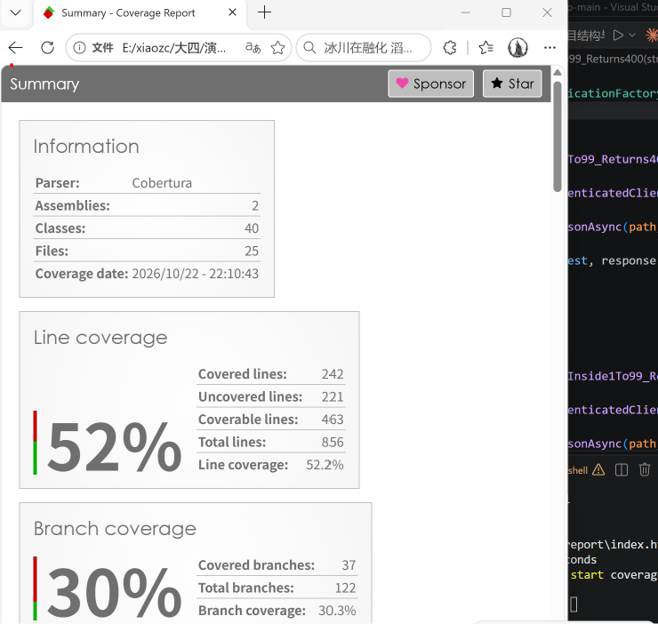

此时覆盖率不高，从报告中发现是web项目代码我们还没测试到，等将来我们完成API测试和网页测试后再来看

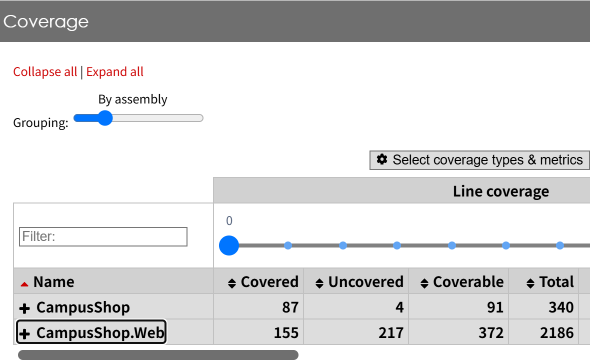

只看我们刚刚进行的单元测试可以看到覆盖率达到了要求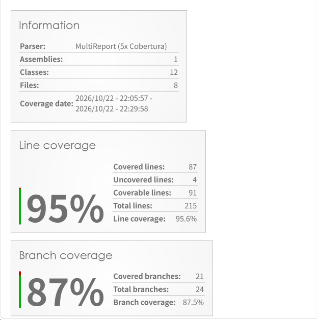si

## 四、变异分数

变异分数 = 被杀死的变异体 / 有效变异体 × 100%

使用stryker.NET来跑变异测试，在powershell中依次运行如下代码

```
dotnet tool install -g dotnet-stryker				#安装 stryker
cd tests\CampusShop.Tests							#进入测试目录
dotnet stryker -m"**/OrderService.cs" -o			#对OrderService做变异测试
```

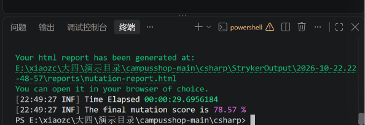

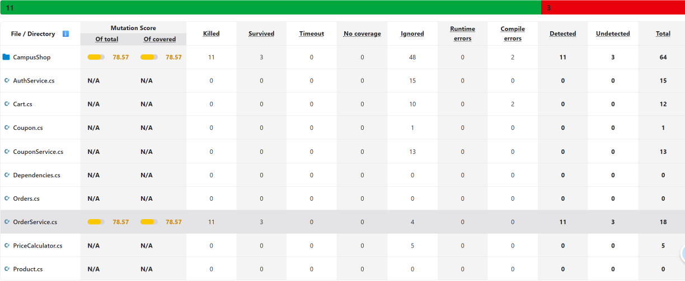

可以看到杀死了11个变异体，存活了3个

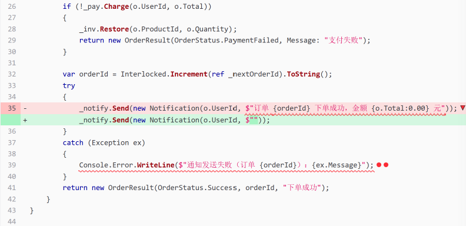

从编译报告源码视图中可以发现，断言没有检查通知情况，可以怎加校验通知发送情况的测试，核对通知内容则没有补测试的价值，杜绝无意义的刷分
提示词示例：

```
基于下面 OrderService 代码，XUnit+Moq 写测试，解决 35 行字符串存活变异。不要硬写死完整字符串对比，只校验通知里携带 UserId、orderId、金额这些业务信息。通知抛异常的场景单独写一条，日志不校验。

namespace CampusShop;
/// <summary>
/// 下单流程。见 docs/requirements.md 第 4 节。
/// </summary>
public class OrderService
{
    private static int _nextOrderId = 1002;
    private readonly IPaymentGateway _pay;
    private readonly IInventoryRepository _inv;
    private readonly INotificationSender _notify;
    public OrderService(IPaymentGateway pay,
        IInventoryRepository inv,
        INotificationSender notify)
    { _pay = pay; _inv = inv; _notify = notify; }
    public OrderResult PlaceOrder(Order o)
    {
        if (_inv.GetStock(o.ProductId) < o.Quantity)
            return new OrderResult(OrderStatus.InsufficientStock, Message: "库存不足");
        _inv.Deduct(o.ProductId, o.Quantity);
        if (!_pay.Charge(o.UserId, o.Total))
        {
            _inv.Restore(o.ProductId, o.Quantity);
            return new OrderResult(OrderStatus.PaymentFailed, Message: "支付失败");
        }
        var orderId = Interlocked.Increment(ref _nextOrderId).ToString();
        try
        {
            _notify.Send(new Notification(o.UserId, $"订单 {orderId} 下单成功，金额 {o.Total:0.00} 元"));
        }
        catch (Exception ex)
        {
            Console.Error.WriteLine($"通知发送失败（订单 {orderId}）：{ex.Message}");
        }
        return new OrderResult(OrderStatus.Success, orderId, "下单成功");
    }
}
```

运行变异测试

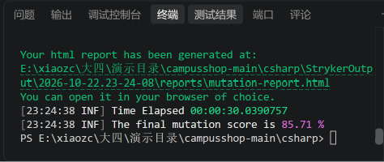

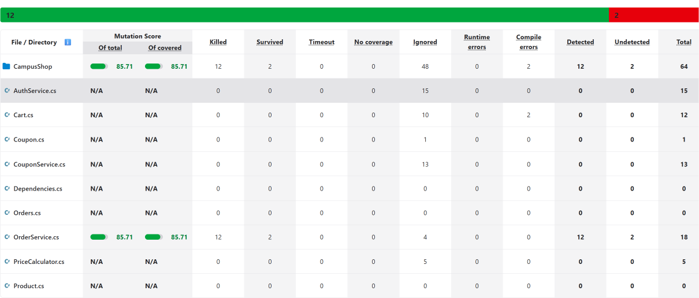

变异分数上涨，成功杀死变异体，接下来按照入上步骤对CouponService.cs和PriceCalculator进行变异测试并消除变异体。