# API测试+Playwright+CI

### 一、环境配置检查

开工前我们需要检查插件状态是否正常

#### 1、启动网站

在终端power shell中输入

```
dotnet run --project csharp/src/CampusShop.Web
```

运行结果中看到

```
Now listening on: http://localhost:5000
```

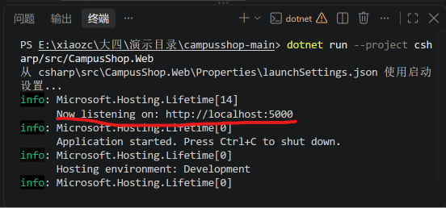

#### 2、装 REST Client 插件

VS Code 左侧扩展图标 → 搜 `REST Client` → 认准作者 `humao` → 安装

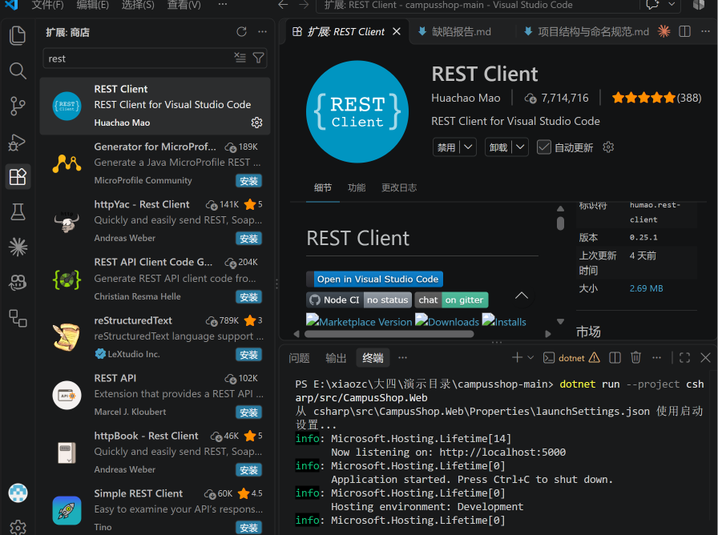

#### 3、下载接口文档

```
另开一个终端：
New-Item -ItemType Directory -Force docs
然后 
Invoke-WebRequest http://localhost:5000/swagger/v1/swagger.json -OutFile docs\openapi.json
```

打开 `docs/openapi.json`，按 `Ctrl+F` 能搜到 `/api/orders`

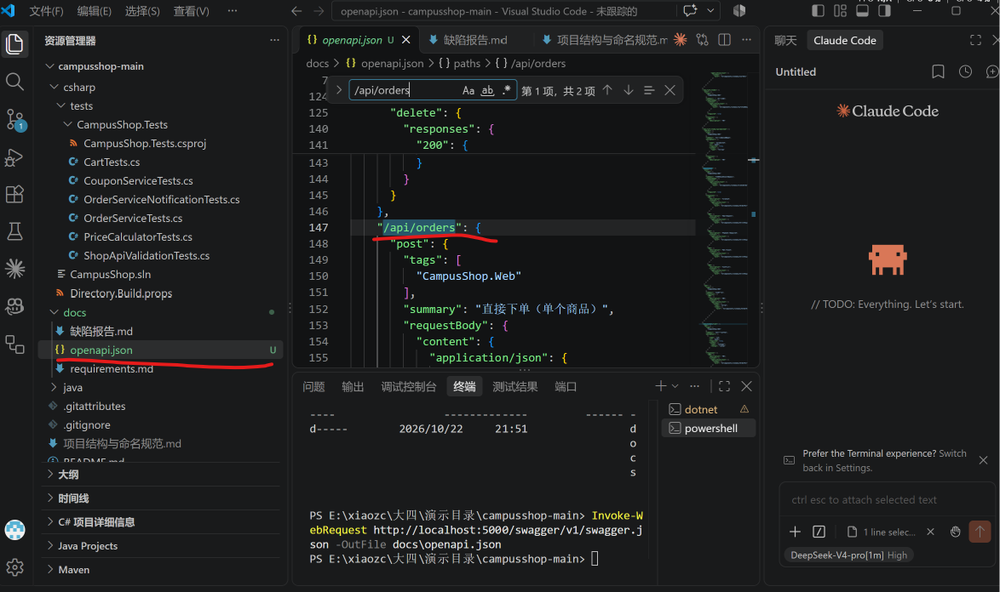

#### 4、装power shell 7

`winget install Microsoft.PowerShell`，装完重开终端，敲 `pwsh -v`显示 `PowerShell 7.x`

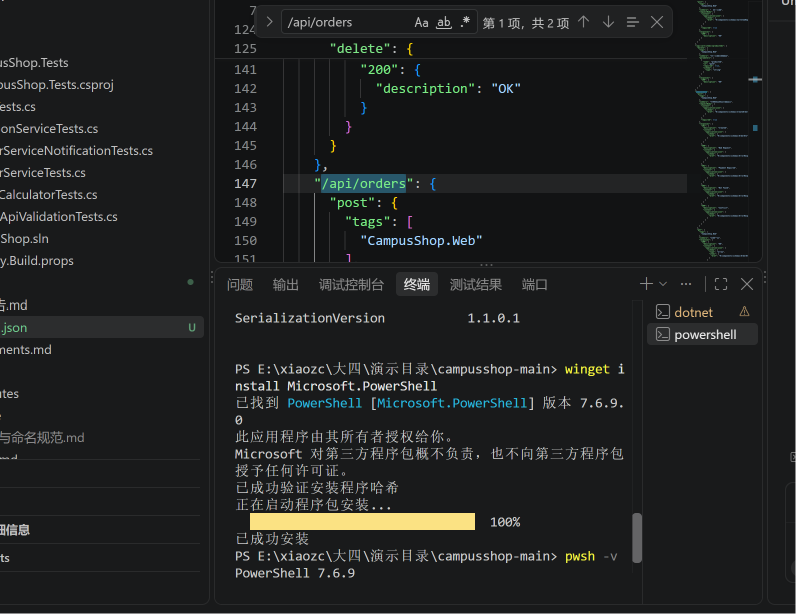

#### 5. 登录 GitHub CLI（阶段 C 要用）

输入命令gh auth status

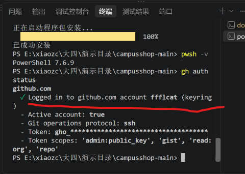

没有的输入gh auth login走浏览器授权，需要自己创建GitHub账号

**6. 确认 Playwright MCP 可用**

 在 AI 工具里问一句："你现在能用 Playwright 打开网页吗？"

不行直接让ai帮你安装

## 二、 API 测试

### 1、手动调试

##### （1） 打开接口文档页

浏览器访问 `http://localhost:5000/swagger`

 看到按 `auth / products / cart / orders` 分组的接口列表

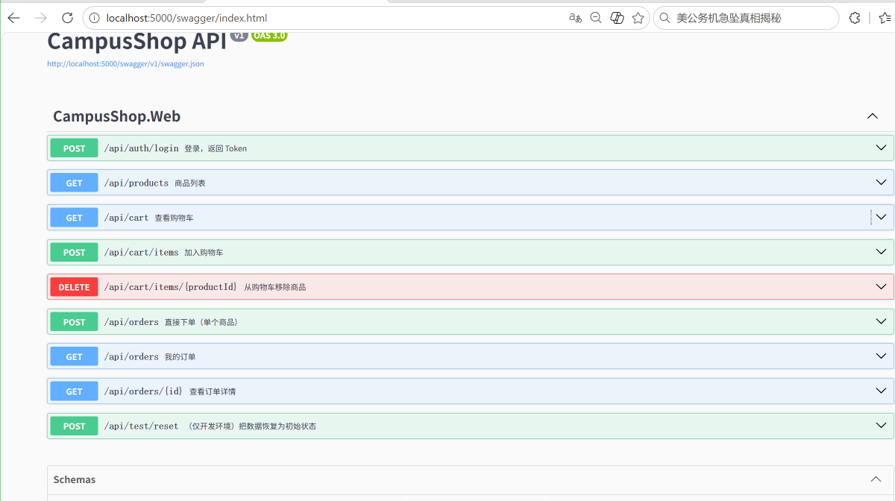

##### （2） 调登录，拿 Token

展开 `POST /api/auth/login` → 点 `Try it out` → 请求体填 `{"username":"alice","password":"123456"}` → 点 `Execute`

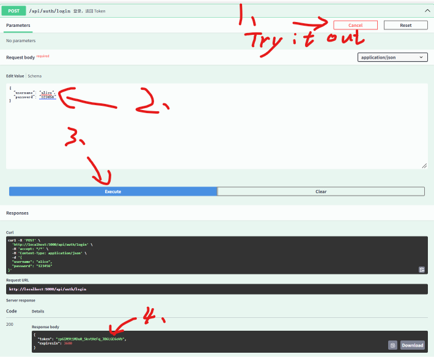

复制下来

**（3）把 Token 贴进 Authorize**

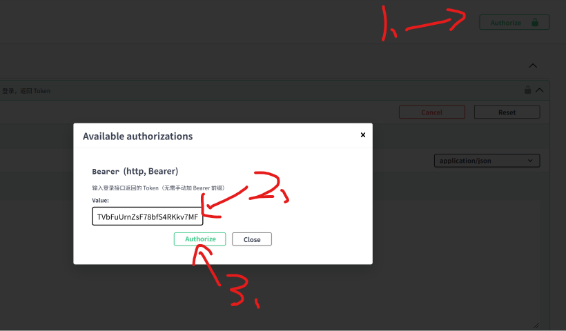

**（4）查自己的订单**

```
展开 `GET /api/orders/{id}` → `Try it out` → id 填 `1001` → `Execute`

响应码 `200`，返回订单内容
```

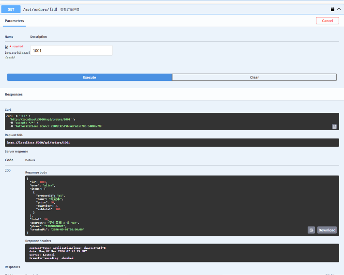

**（5） 去掉 Token 再查一次**

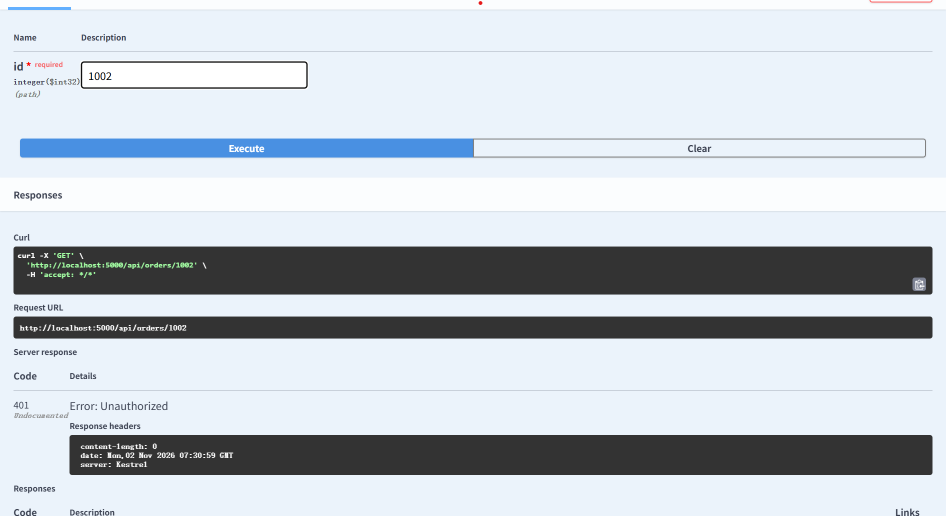

可以看到响应码变为401

到这里你已经亲眼见过 200、401 和 Token 长什么样。这就是后面所有断言的原型。

### 2、让ai出场景表

#### （6）复制下面这段提示词

在 AI 工具里 `@` 引用 `docs/openapi.json` 和 `docs/requirements.md`，粘贴提示词

```
你是一名 API 测试工程师。根据 @docs/openapi.json 和
@docs/requirements.md，为 /api/orders 相关接口设计集成测试。

先不要写代码。对每个接口，按以下类别推导场景：
正常、缺少必填字段、取值非法、未认证、无权限、
资源不存在、业务冲突。
输出表格：
| 接口 | 场景 | 请求要点 | 期望状态码 | 响应体检查 | 副作用检查 |

确认后，用 xUnit + WebApplicationFactory 生成测试。约束：
- 用辅助方法 LoginAs(user) 现场获取 Token，不得硬编码
- 每个测试独立准备数据，不依赖执行顺序
- 金额期望值按 requirements.md 计算并注明过程
- 不要修改被测代码；生成后运行并报告
```

#### （7）人工补漏（这一步必须做）

```
逐行对照上面的 7 类，缺哪类就回一句："还缺 XX 场景，补上"
表里出现"数量 0 / -1 / 99 / 100"四个边界，并且出现"别人的订单 / 403 或 404"这一行
AI 十有八九会漏掉"越权"这一行，这不是你的错，是它的通病，必须你自己加
```

#### **（8） 让 AI 按场景表写代码**

```
回一句："按这张表生成测试代码，约束照旧"
生成的文件里有 `LoginAs` 这样的辅助方法，Token 是现场登录拿的，不是写死的长字符串
```

#### （9）跑起来

`dotnet test --filter OrderApiTests`

多数通过；如果出现 `Expected: BadRequest Actual: Created`（数量 -1），**这是预埋

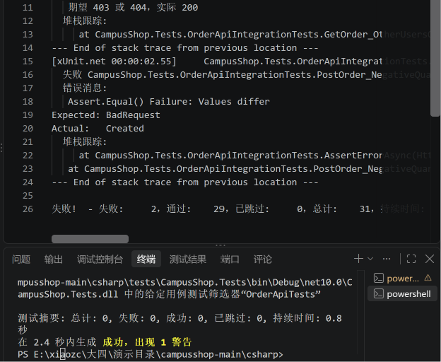

#### **（10） 逐项审查**

| 检查什么                                                     |
| ------------------------------------------------------------ |
| 七类场景是否都在                                             |
| 有没有"只断言 200"的测试                                     |
| 代码里有没有一长串写死的 Token 或订单号                      |
| 期望状态码里有没有出现 500（出现就是错的）                   |
| 有没有越权测试                                               |
| 至少 1 条测试同时检查了"状态码 + 响应体 + 副作用"（三层断言） |

可能上面测试的用例缺少越权测试，下面我们来学习越权测试

### 3、做越权测试，抓缺陷 7

**（11）先让 AI 补一条越权测试**

```
为 GET /api/orders/{id} 补一条越权测试：
- bob 先自己创建一笔订单，拿到订单号
- alice 用自己的 Token 去请求 bob 的这笔订单
- 期望 403 或 404
- 订单号必须由测试自己创建，不得写死
```

​	跑 `dotnet test --filter GetOrder_OtherUsersOrder`

​	测试**失败**，报 `Actual: OK`——这就是缺陷 7 被抓住的样子

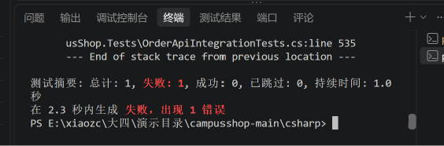

####  （12）手动复现一次

回 Swagger，用 alice 登录拿 token → `Authorize` → 请求 `GET /api/orders/1002`

返回 `200`，响应体里是 **bob** 的地址和手机号

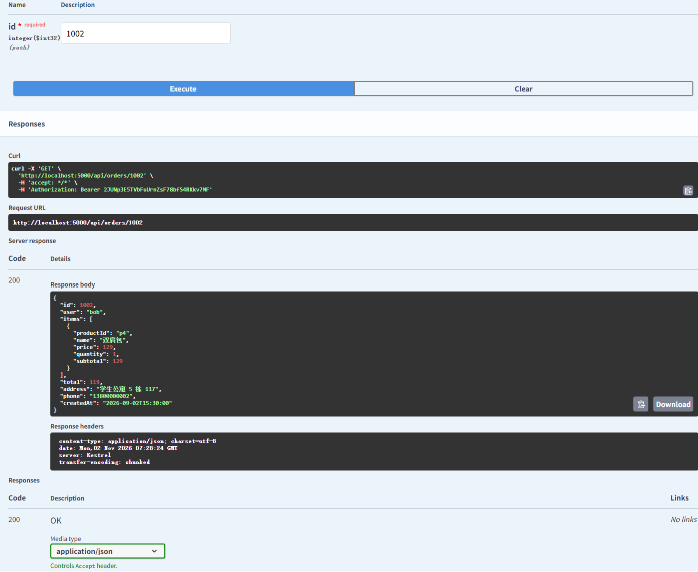

从截图中可以看出，从alice的账号登录进去，可以查看bob的订单和隐私信息，即我们刚刚抓到的越权缺陷

#### （13）写缺陷报告

 新建一个 Markdown 文件，按这 6 行填：

```
标题：越权查看他人订单
严重程度：高
接口：GET /api/orders/{id}
复现步骤：alice 登录拿 Token → 请求 bob 的订单 1002
实际结果：200，返回 bob 的地址、电话
期望结果：403 或 404，且不返回订单内容
```

报告里有手动复现截图 + 失败测试的截图

## 4、让 AI 修，然后验收

#### （14）修越权

```
修复越权问题：查询订单时检查订单的 UserId 是否等于当前登录用户，
不匹配返回 404。不要修改测试，不要修改 .github 下的文件。
修复后运行全部 API 测试并报告结果。
```

 再跑第 11 步那条测试变成 `Passed`

顺手问 AI 一句："还有哪些接口也接收订单 id？"——取消订单、订单详情往往被漏掉

#### （15）修复缺陷4和5

```
修复两个缺陷：
1. 下单接口接受负数数量：数量必须为 1..99 的整数，否则返回 400；
2. 登录接口缺少 username 时抛空引用异常：在入口校验，返回 400 和明确错误信息。
不要修改测试和 workflow。修复后运行全部测试并报告。
```

## 三、playwright E2E

### 1、 装环境，跑通示例

#### （16）开两个终端

终端 1：`dotnet run --project csharp/src/CampusShop.Web`

终端 1 出现 `Now listening on: http://localhost:5000`

#### （17）构建 E2E 项目

 终端 2：`cd csharp/tests/CampusShop.E2E`，然后 `dotnet build`

 显示 `Build succeeded`

#### （18）装浏览器

`pwsh bin/Debug/net10.0/playwright.ps1 install chromium`

 进度条走完，没有红色报错

#### （19）跑示例测试

```
dotnet test
Passed! - Failed: 0, Passed: 1
想看见浏览器：$env:HEADED="1"; dotnet test
```

### 2、录一个登录测试

#### （20）启动录制

 `pwsh bin/Debug/net10.0/playwright.ps1 codegen http://localhost:5000`

弹出两个窗口：左边浏览器，右边代码窗口

**（21） 在浏览器里走一遍**

输入 `alice / 123456` → 点登录

页面显示"欢迎，alice"

**（22）让录制帮你加断言**

代码窗口工具栏点"断言文字"，再点页面上的"欢迎，alice"

代码窗口里多出一行断言

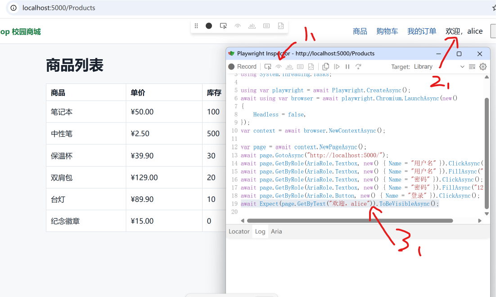

**（23） 清理生成的代码（三件事）**

```
删掉每个"填写"前面多余的"点击"那行
检查定位符，不是"按角色/按标签/按 testid"的，全部换掉
代码里没有 `sleep`、没有 `#app > div` 这种层级路径
```

**（24） 存成测试文件并运行**

粘进测试文件 → 清掉环境变量 `Remove-Item Env:HEADED` → `dotnet test --filter Login`

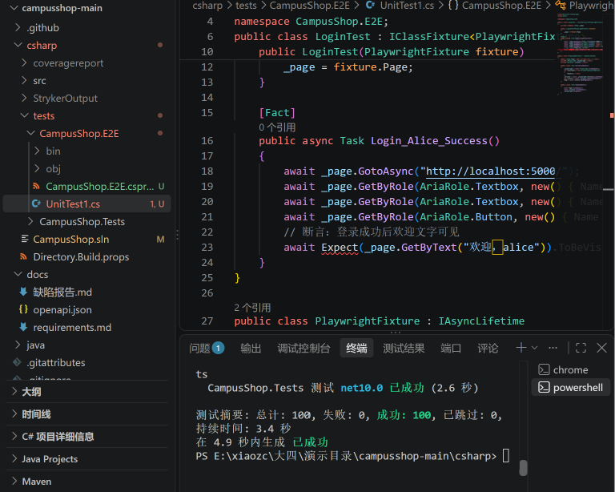

### 3、让 AI 写"下单"测试

#### （25） 第一步：让 AI 先看页面，不写代码

##### 提示词：探索页面

```
第一步（不写代码）：
使用 Playwright 工具打开 http://localhost:5000，完成以下流程：
用 alice / 123456 登录 → 把“笔记本”加入购物车，数量 2
→ 进入购物车 → 点击下单。
记录每一步用到的元素（角色、名称或标签）
以及每一步之后页面上出现的关键信息。
```

#### （26）第二步：按清单生成测试代码

 **提示词 ：生成下单测试**

```
第二步：根据记录，用 NUnit + Playwright 写 E2E 测试
Order_TwoNotebooks_ShowsOrderNumber。要求：
- 定位符优先 GetByRole / GetByLabel，其次 GetByTestId
- 断言用 Expect(...)，不得使用 sleep / WaitForTimeout
- 断言购物车总价（按需求计算）与订单号格式
- 测试自己登录，不依赖其他测试
```

跑 `dotnet test --filter Order_TwoNotebooks`

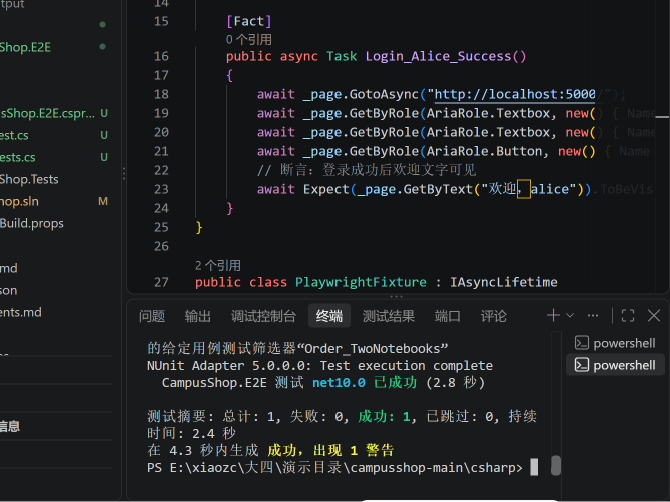

#### （26）同一轮对话里，再要一个"登录失败"测试

##### 提示词 ：登录失败（讲义整理）

```
再写一个 E2E 测试 Login_WrongPassword_ShowsError：
用 alice 和错误密码登录，断言页面上出现“用户名或密码错误”。
错误提示用 GetByTestId("error-msg") 定位，不要 sleep，
不要只断言网址还停在登录页。
```

跑dotnet test --filter Login_WrongPassword

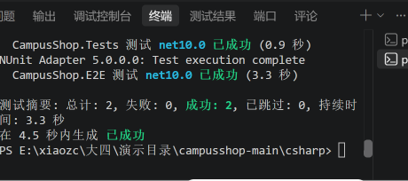

**（27）两条断言必须亲眼看到**

打开生成的代码，找这两行

 一条断言总价是 `¥90.00`（50 × 2 = 100，满 100 减 10）；一条断言订单号格式以 `CS` 开头

只有"页面标题对""网址对"的测试等于没测，退回去让 AI 补

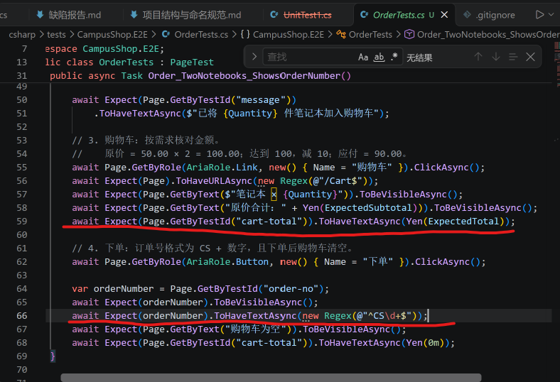

### 4、抓缺陷8：空购物车还能下单

#### （28）让AI写这个测试

提示词 7：空购物车

```
写一个 E2E 测试：用 bob 登录（购物车为空）→ 进入购物车 →
断言页面显示“购物车为空”，并且“下单”按钮处于禁用状态。
定位符用 GetByRole / GetByText，断言用 Expect，不要 sleep。
```

# 四、CI流水线

## 1、把代码推到自己的仓库

#### （29）确认登录、改远程

```
gh auth status
- Logged in to github.com as 你的用户名
git remote rename origin upstream
- git remote -v 里能看到 upstream
```

**（30）建自己的仓库并推送**

 `gh repo create campusshop-你的名字 --public --source . --remote origin --push`

 终端显示 `Created repository` 和 `Pushed commits`

 `gh repo view --web`

 浏览器里能看到你的代码，顶部有 `Actions` 标签

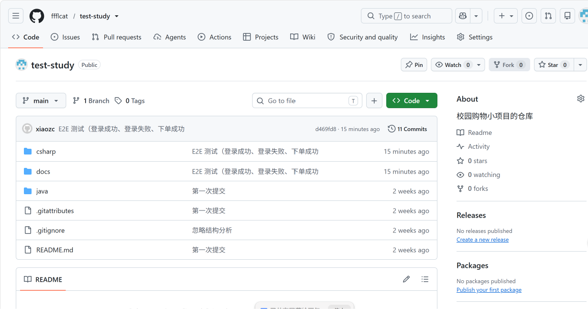

### 2、 让 AI 写流水线

**（31）复制提示词**

```
为 CampusShop 的 C# 版本编写 GitHub Actions
workflow（.github/workflows/ci.yml）：
- 触发：push 到 main、所有 pull_request
- 作业 1：运行单元测试与 API 测试，收集覆盖率，
  始终上传测试结果
- 作业 2：在作业 1 通过后运行 E2E 测试：后台启动
  网站、等待就绪、安装 chromium、运行测试；
  失败时上传 traces 目录
- 只使用 actions/ 组织下的官方动作
- 不得忽略任何测试失败
```

生成了ci.yml
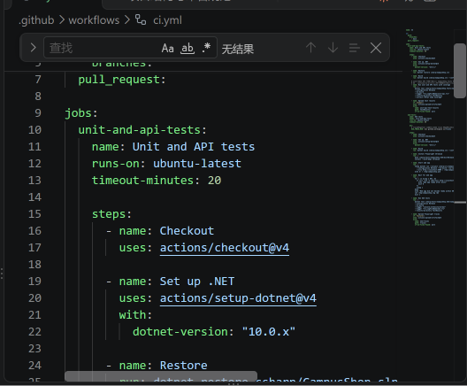

### 3、推上去，看它变绿

#### （32）提交并观察

`git add .github`，`git commit -m "添加 CI 流水线"`，`git push`

`gh run watch`

 两个作业依次变绿：`unit-and-api`、`e2e`

#### 红了怎么修

提示词：修 CI 失败

```
CI 的 unit-and-api 作业失败。日志如下：
<把 gh run view --log-failed 的输出粘在这里>

诊断：<写你判断的原因，例如：代码用了本地时间，CI 是 UTC>

请修复这个问题。约束：
- 不得修改 .github/ 下的任何文件
- 不得修改测试的期望值
- 不得使用 Skip 或注释掉测试
完成后在本地运行全部测试并报告结果。
```

本地 `dotnet test` 全绿后再 `git push`

`gh run watch` 看到变绿

